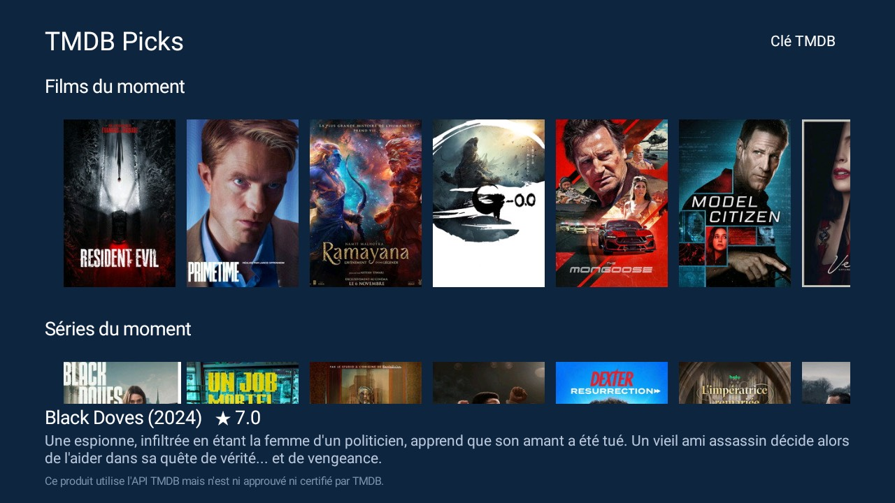

# TMDB Picks

Movie and series recommendations from [TMDB](https://www.themoviedb.org/), limited to what Netflix, Disney+, Prime
Video and Canal+ offer in their subscription. Its main place is a large banner on the launcher's home screen (below);
the app itself shows them as rows of posters, with the title, year, rating and synopsis of the one in focus. For the [Clean Your TV](../../README.md) launcher it declares a [module card](../../docs/modules.md), so
once you answer **Show card** its tile reads "TMDB Picks"; on any other Android TV home it is an ordinary app.

This product uses the TMDB API but is not endorsed or certified by TMDB.



## Your TMDB key

You need a free TMDB API key (themoviedb.org, Settings, API). The key is never in this repository or in the APK:

1. Open the app. With no key it shows a QR code.
2. Scan it with your phone, on the same Wi-Fi as the TV. A page opens on the TV's address.
3. Paste the key (the 32-character v3 key or the long v4 token) and send it. The TV checks it with TMDB, keeps it
   in the app's private storage and shows the posters.

**TMDB key** at the top right forgets the key and shows the code again.

The page is plain HTTP on your home network, served by the TV for as long as the pairing screen is open. The
address in the QR code carries a random one-time token, nothing is served without it, and the server stops as soon
as a key is saved or the screen closes. Do not pair on a network you do not trust.

## On the home screen

With `picks_hero` on in the launcher (`launcher/app/src/main/res/values/config.xml`, or a theme's `config.json`) the
home screen gets a large **Recommendations** banner above the dock, in the manner of a streaming home: one title at
a time on a wide picture, with its name, the service and a summary, changing every 8 seconds. OK opens that
service's app, Left and Right change the title, Down goes to the dock. The banner starts with what you were
watching (from `extras/reprendre`) and goes on with the recommendations; it takes the place of the Continue
watching row.

The launcher keeps no network access: this app serves the titles and downloads the pictures through the content
provider `com.gathin.tmdbpicks.items`, in the same shape as Reprendre's. The provider hands out titles, summaries and
pictures of the latest list, never the key.

## Which titles

Only titles **included in a subscription** (no purchase, no rental) on Netflix, Disney+, Prime Video or Canal+, as TMDB
(JustWatch data) lists them for France (`Services.REGION`), most popular first, movies and series in turn and the
services taking turns. Only services whose app is installed on the TV count, so every title can be opened. The list
is fetched at most every six hours and kept in the app's private storage.

Opened on its own the app shows the same titles in one row of posters per service.

## What it does

- Reads TMDB when the list is older than six hours (when the launcher or the app asks) and does nothing in the
  background otherwise.
- Posters are kept in memory only (up to 12 MB) and dropped when the app closes; the banner's pictures are cached
  on disk and dropped when their title leaves the list.
- No account, no telemetry, no ads.

## Permissions

| Permission | Why |
|---|---|
| `INTERNET` | The lists and pictures from TMDB (`api.themoviedb.org`, `image.tmdb.org`), and the one-page key server on the home network while the pairing screen is open. |

It also declares `<queries>` for the four streaming apps, to know which are installed, and exports a read-only content provider for the launcher.

No background service, no start at boot.

## Build

```bash
cd addons/tmdb-picks
./gradlew --no-daemon testReleaseUnitTest assembleRelease
adb install -r app/build/outputs/apk/release/app-release.apk
```
